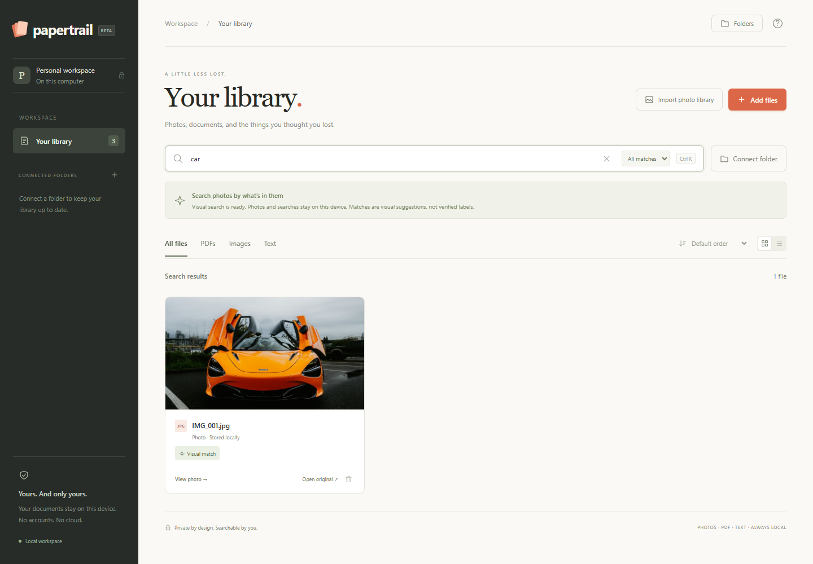

<p align="center"></p>

<p align="center"><strong>Search your photos by what's in them. Search your documents by what they say.</strong><br>Private. Local. No account or API key.</p>

<p align="center"><a href="#start-on-windows">Get started</a> · <a href="#how-it-works">How it works</a> · <a href="#features">Features</a> · <a href="#support-the-project">Support</a></p>

You remember the orange sports car, but the photo is called `IMG_001.jpg`. You remember a warranty, but not which PDF contains it. Papertrail gives those files a searchable home on your own computer.

Import a folder, then search **“car,” “mountains,” or “warranty.”** Photos are matched by visual content; documents and scans are searched through their text. Your files and queries stay on your device.



*A real result from the test library: “car” has no filename or OCR match. The image is retrieved through visual similarity. Photo: [Luke Miller / Unsplash](https://unsplash.com/photos/bright-orange-mclaren-supercar-with-doors-open-5JPCIIOdrM8).*

**Status: early beta.** Tested on Windows with Python 3.12. Visual results are approximate, and very large libraries have not been benchmarked.

## Start on Windows

1. Install [Python 3.12](https://www.python.org/downloads/) and make it available on your PATH.
2. Download this repository using **Code → Download ZIP**, then extract it.
3. Double-click **Start Papertrail.cmd** in the extracted folder.
4. Choose **Import photo library → Browse → Use this folder → Import library**, or **Add files** for individual files.
5. Search for an object, scene, filename, or words inside a document.

The first photo import downloads the CLIP vision model (about 600 MB). Its setup status appears in the app. Once cached, photo indexing and search work offline. Keep the launcher window open while using the app. If Papertrail is already running on its usual port, the launcher opens that instance.

## Features

- **Whole photo libraries:** browse local folders inside the app, use the Pictures shortcut, or paste a path. Includes every subfolder, supports connected drives, and leaves originals in place. JPG, PNG, HEIC/HEIF, WebP, AVIF, TIFF, and BMP are supported; videos and camera RAW are not.
- **Connected folders:** optional automatic sync checks for new, changed, and deleted files every 15 seconds while the app is running. Pause, resume, sync now, or disconnect from the Folders panel. An unavailable drive keeps its existing index.
- **Resumable imports:** stop after the current file; completed work stays searchable. Use Sync now or Resume sync to continue, skipping unchanged files.

- **Visual photo search:** CLIP matches natural-language descriptions with image content, independent of filenames and OCR. Try `car`, `orange sports car`, `cat`, or `mountains`.
- **Hybrid results:** exact text matches first, then visual matches. Switch between All matches, Visual only, and Text only.
- **Local OCR:** extracts words from images and scanned PDF pages.
- **Original previews:** photo thumbnails and original PDF pages, page navigation, zoom, and an extracted-text view.
- **Document search:** ranked full-text results with highlighted passages and page numbers. One result per file, with buttons to jump between matching PDF pages. Prefix matching and common question-word removal help with searches such as `where is my warranty`.
- **Import lifecycle:** progress, per-file errors, model failure recovery, retry of pending visual indexes, unchanged-file skipping, and pruning deleted files on folder re-import.
- **Library controls:** file-type and folder filters, grid/list views, name/date sorting, incremental result rendering, exact duplicate upload detection, and a two-minute undo after removal.
- **Persistent visual index:** image fingerprints are stored with their model version; searches do not re-encode every photo.
- **Local service:** loopback binding, API token checks, same-origin browser assets, and no telemetry in the model setup.

## How it works

Papertrail combines two local search methods:

1. **Photos → visual fingerprints.** OpenAI's CLIP model converts each photo into a small numerical representation called an embedding. A search such as “orange sports car” is converted into the same kind of representation. Comparing them retrieves photos with similar visual meaning—even when there are no words in the image.
2. **Documents and scans → searchable text.** PDF text is extracted directly. Images and scanned pages pass through OCR to read their words. SQLite's full-text search finds matching filenames and passages.
3. **One library → two kinds of results.** Text matches appear first, followed by visual suggestions. Choose **Text only** or **Visual only** to see either method separately.
4. **Index once, reuse later.** Text, thumbnails, and photo embeddings are stored locally. Unchanged files skip re-indexing. Optional folder sync checks for changes every 15 seconds while Papertrail is running.


The interface is plain HTML, CSS, and JavaScript served by Python on `127.0.0.1`. There is no hosted backend or paid AI API. Internet access is needed for initial dependency and model downloads; cached inference runs offline.

## What visual matching means

Visual similarity is a suggestion, not a verified identification. It can confuse shapes and concepts: an exotic car may also match “spaceship.” Specific brands, exact models, faces, counts, and small details are not reliable. The matching threshold is a heuristic, not a calibrated confidence probability. Search is English-first. Long descriptions are truncated to CLIP's 77-token input limit.

Photos use visual search. PDF pages use text/OCR search; they are not visually embedded. There is no document chatbot or native installer yet. Large photo libraries take time to index on CPU; progress and per-file errors are shown. Cloud-only photos must first be downloaded to a local folder. This does not connect directly to iCloud or Google Photos.

## Storage and privacy

- Folder imports reference originals. Uploads create a copy under `.papertrail/uploads`.
- SQLite stores paths, extracted text, thumbnails, and image embeddings in `.papertrail/index.sqlite`.
- Model files are cached in `.models`. First setup downloads dependencies and public weights; no personal files or queries are sent to the model host.
- Removing a file leaves the original or uploaded copy untouched and excludes that path from future folder syncs. Undo restores it for two minutes while the server remains running. After that, use Add files to upload it again. Disconnecting a folder stops syncing but keeps its indexed files.
- Data is unencrypted. Stop the app before deleting `.papertrail` to reset the library. That also deletes uploaded copies stored there. Model files are separate.
- Set `PAPERTRAIL_DATA` and `PAPERTRAIL_MODELS` to choose other locations.
- This is a single-user local application. Do not expose it to a public network.

## Manual setup / development

Python 3.12 on Windows is tested. macOS/Linux code paths exist but are not validated here.

```sh
python bootstrap.py --prepare-only
```

Windows:
```powershell
.venv\Scripts\python app.py
```

macOS / Linux:
```sh
.venv/bin/python app.py
```

Open http://127.0.0.1:8765. `python launch.py` opens the browser and chooses another port if needed. The model can be prepared in advance with `python vision.py` inside the environment.

## Tests

```sh
python -m unittest discover -s tests -v
pip install playwright
python -m playwright install chromium
python tests/browser_check.py
python tests/visual_e2e.py /path/to/visual-fixtures
python tests/library_e2e.py /path/to/visual-fixtures
```

The visual acceptance suite uses **real CLIP inference**, three generic filenames (car/cat/mountain), upload through the browser, a text-only negative control, preview rendering, mode switches, mobile layout, offline process restart, persistence, deletion, and unauthenticated API rejection. See `tests/FIXTURES.md` for test image sources and preparation. These three examples validate the feature, not universal retrieval accuracy.

Core tests also cover recursive HEIC import, photos-only filtering, folder browsing, PDF grouping/rendering/page counts, cancellation/resume, automatic updates, offline-drive preservation, and undo. The library browser suite checks folder selection, bulk import, sync/pause/resume, duplicate uploads, original PDF navigation, and mobile layout using a temporary library.

## Model

[OpenAI CLIP ViT-B/32](https://huggingface.co/openai/clip-vit-base-patch32), pinned to revision `3d74acf9a28c67741b2f4f2ea7635f0aaf6f0268`, through Hugging Face Transformers. Text and image embeddings share a space and are compared by cosine similarity. Inference uses CPU, capped at four threads. Model weights are not bundled into the source repository.

## Contributing

Bug reports, practical feature ideas, and pull requests are welcome. See [CONTRIBUTING.md](CONTRIBUTING.md) for setup, testing, and how to share a safe reproduction. Please use sample files instead of personal photos or documents.

If Papertrail helps you find something you thought you'd lost, a star helps other people discover it.

## Support the project

Papertrail is free and open source. If you'd like to support its development, you can send a donation through **[PayPal](https://www.paypal.com)** to:

**alalifaris22@gmail.com**

Open PayPal, choose **Send**, and enter that email as the recipient. Donations are optional; every feature is available without paying. Thank you for supporting the project.

## License and credits

The project source is available under the [MIT License](LICENSE). Dependencies and CLIP weights retain their own licenses. Demo photography is credited in [docs/CREDITS.md](docs/CREDITS.md).

The Papertrail name has not been checked for trademark or package availability.
